<p align="center">
  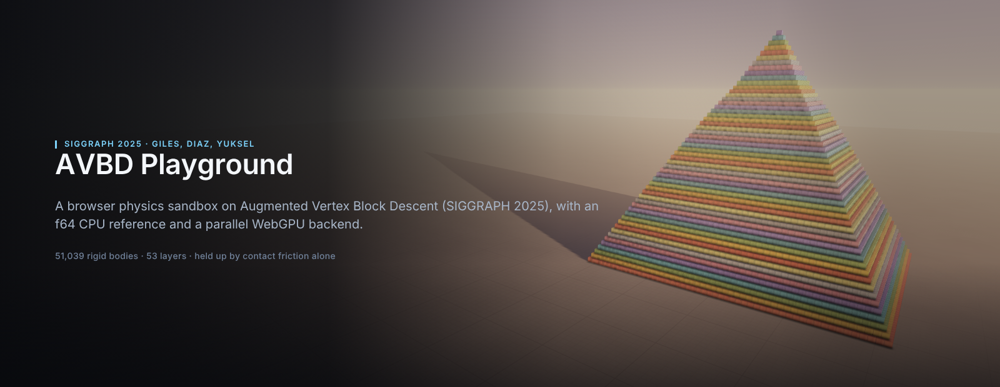
</p>

<p align="center">
  <a href="https://itchyfeetleech.github.io/avbd-sandbox/"><strong>▶ Open the live sandbox</strong></a>
  &nbsp;·&nbsp;
  <a href="#scenes">Scenes</a>
  &nbsp;·&nbsp;
  <a href="docs/implementation.md">Implementation notes</a>
  &nbsp;·&nbsp;
  <a href="https://doi.org/10.1145/3731195">The paper</a>
</p>

<p align="center">
  
  
  
  <a href="https://github.com/itchyfeetleech/avbd-sandbox/actions/workflows/ci.yml"></a>
  <a href="https://github.com/itchyfeetleech/avbd-sandbox/actions/workflows/pages.yml"></a>
</p>

---

A physics playground in the browser, built on **Augmented Vertex Block Descent**, the
SIGGRAPH 2025 rigid-body solver by Giles, Diaz and Yuksel. Throw ragdolls down a flight of
stairs, overload a suspension bridge until its welds snap, swing a wrecking ball through a
building, pull blocks from a tower — then drop fifty thousand boxes on all of it.

Two interchangeable backends sit behind one scene graph: an f64 CPU reference engine, and a
WebGPU compute backend that solves the same equations in parallel at tens of thousands of
bodies. No build step, no dependencies.

> Chris Giles, Elie Diaz, Cem Yuksel. **Augmented Vertex Block Descent.**
> ACM Transactions on Graphics 44(4), Article 90 (SIGGRAPH 2025).
> [doi:10.1145/3731195](https://doi.org/10.1145/3731195) ·
> [project page](https://graphics.cs.utah.edu/research/projects/avbd/)

## Scenes

Twenty-two scenes ship with the sandbox, from paper figures to fifty-thousand-body stress
tests. Every animation below is rendered by the engine itself at a fixed timestep
([how](tools/capture)).

<table>
<tr>
<td width="50%">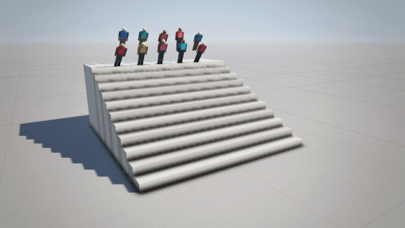</td>
<td width="50%">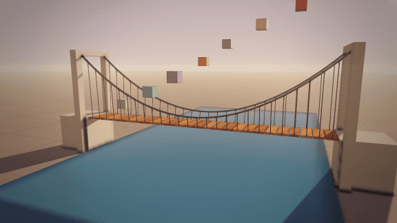</td>
</tr>
<tr>
<td><b>Ragdoll stairs</b><br>Ten boxes and a sphere per figure, joined by ball sockets with soft angular stiffness, pitched down eleven stone steps.</td>
<td><b>Suspension bridge</b><br>The cables are chains of hard joints, so their sag is solved, not drawn. The deck's welds snap under the ball and the hangers tear past 5% stretch.</td>
</tr>
<tr>
<td>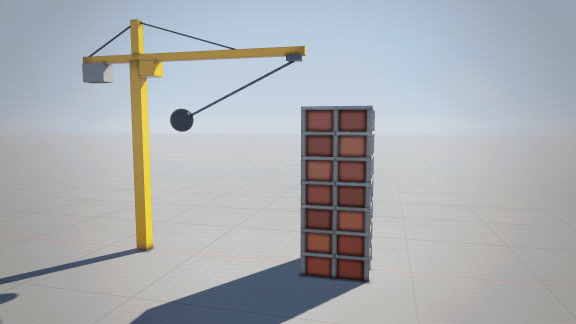</td>
<td>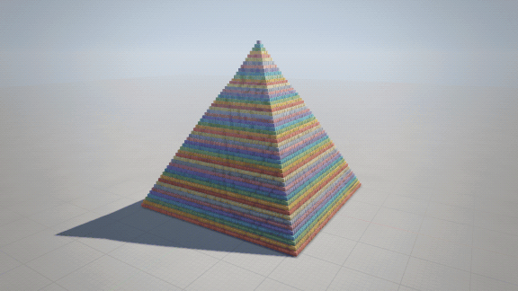</td>
</tr>
<tr>
<td><b>Wrecking ball</b><br>A tower crane swings 67 kg into a seven-storey frame of columns, slabs and walls standing on friction alone.</td>
<td><b>51,039 bodies</b><br>Fifty-three layers held up by contact friction, taking a hit at the apex. WebGPU.</td>
</tr>
<tr>
<td>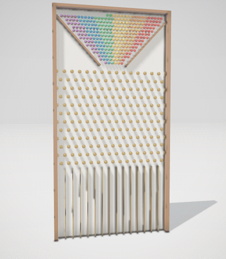</td>
<td>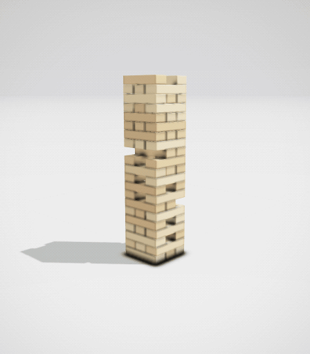</td>
</tr>
<tr>
<td><b>Galton board</b><br>280 balls through twelve rows of pegs fill the bins toward a bell curve. Five times real time.</td>
<td><b>Block tower</b><br>Eighteen levels in mid-game, eight blocks already moved to the top, standing until something hits the base.</td>
</tr>
<tr>
<td>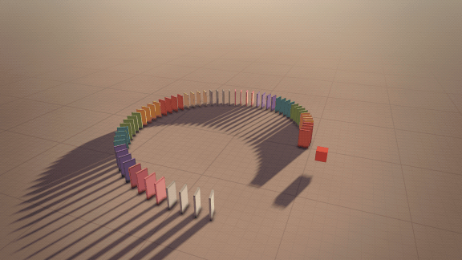</td>
<td>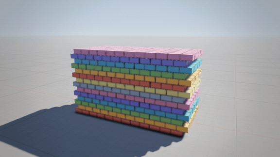</td>
</tr>
<tr>
<td><b>Dominoes</b><br>Sixty thin boxes on a spiral. Sensitive to contact accuracy and friction.</td>
<td><b>Deep frictional pile</b><br>The paper's headline scene: a settled pile, then a heavy impact (Figs. 1 &amp; 3).</td>
</tr>
<tr>
<td>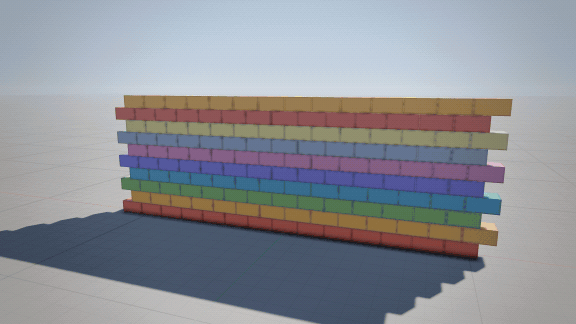</td>
<td>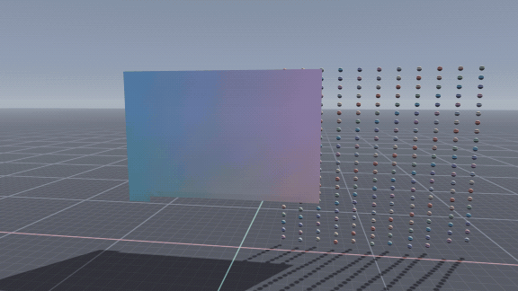</td>
</tr>
<tr>
<td><b>Fracture</b><br>Bricks bonded by hard constraints with a force threshold. The dual variable is the constraint force, so breaking reads straight off it (Fig. 13).</td>
<td><b>Cloth and rope</b><br>Spring-lattice fabric with structural, shear and bend links, tearing at a configurable strain; ropes drawn as continuous tubes.</td>
</tr>
</table>

Further scenes reproduce figures from the paper: the 50-link heavy pendulum at a 26,000:1
mass ratio (Fig. 7), two heavy masses on a chain (Fig. 9), the box stack (Fig. 10), the
friction ramp (Fig. 11), the house of cards (Fig. 6), the 1000:1 stiffness-ratio spring
chain (Figs. 2 & 4) and the articulated pole (Fig. 5). Two more dense presets, **Mega
wall** and **Filled basin**, carry roughly fifty thousand bodies each.

## A sandbox, not a slideshow

<p align="center">
  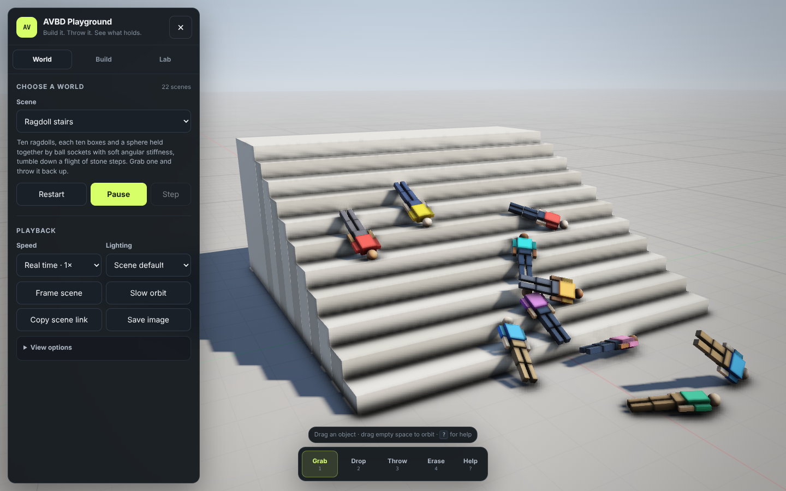
</p>

- **Build** anything the scenes are made of: rain, towers, walls, pyramids, rings, clusters,
  fabric sheets, ropes and ragdolls, all placed contact-free, with material presets for
  grip, bounce and weight.
- **Grab, Drop, Throw, Erase.** Drag a body through the world on a joint; paint objects
  where you point; fire the selected shape, or a ragdoll, from the camera.
- **Light it** four ways, or keep each scene's own look. Turn on a slow orbit, save the view
  as a PNG, or copy a link that reopens the same scene and lighting.
- **Look inside** from the Lab: switch between the CPU and WebGPU engines mid-run, check the
  GPU against the CPU reference, profile each compute pass, or change the solver's own
  parameters.

<table>
<tr>
<td width="25%">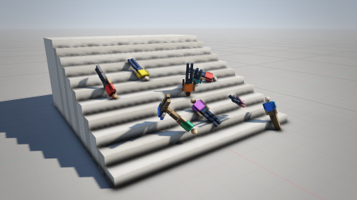</td>
<td width="25%">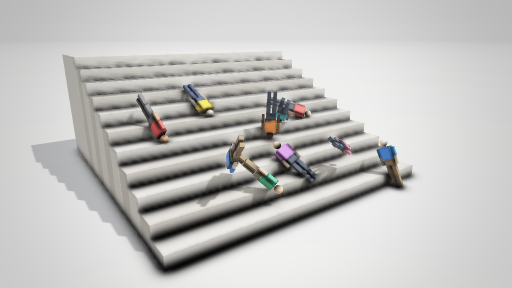</td>
<td width="25%">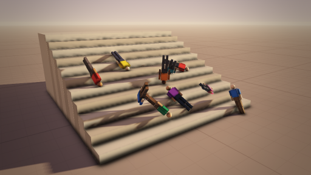</td>
<td width="25%">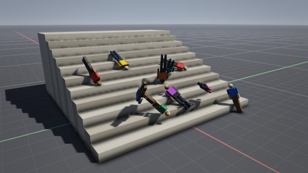</td>
</tr>
<tr>
<td align="center">Daylight</td>
<td align="center">Studio</td>
<td align="center">Dusk</td>
<td align="center">Blueprint</td>
</tr>
</table>

## Run it

The hosted build is the easiest way in: **[itchyfeetleech.github.io/avbd-sandbox](https://itchyfeetleech.github.io/avbd-sandbox/)**.

Locally there is no build step — the source is plain ES modules:

```bash
node tools/serve.mjs
# http://127.0.0.1:8123/
```

Opening `index.html` over `file://` will not work; browsers block module imports on that
scheme. Serve a public deployment over HTTPS so WebGPU is available — browsers without it
fall back to the CPU engine and WebGL2, which `?nogpu=1` also forces.

For a single self-contained file that can be emailed or opened directly:

```bash
node tools/bundle.mjs
# writes dist/avbd-sandbox.html
```

`npm test` runs the checks that need only Node; [Verification](docs/verification.md)
covers the rest, including the GPU runs that CI makes in headless Chrome and Deno.

## Controls

| Panel | What it holds |
|---|---|
| **World** | Scene selection, playback speed, lighting, framing, slow orbit, sharing and saving |
| **Build** | Contact-free arrangements of rigid bodies, fabric, ropes and ragdolls, with material presets and optional fine tuning |
| **Lab** | CPU or WebGPU engine, solver fidelity, a GPU-against-CPU cross-check, profiling, world-safety controls |

Drag empty space to orbit, right-drag or drag with two fingers to pan, scroll or pinch to
zoom; the tools work with touch too.

<kbd>1</kbd>–<kbd>4</kbd> select tools, <kbd>Space</kbd> pauses, <kbd>.</kbd> steps,
<kbd>R</kbd> restarts, <kbd>Z</kbd> undoes an add, <kbd>F</kbd> fires,
<kbd>Home</kbd> frames the scene, <kbd>O</kbd> orbits, <kbd>P</kbd> saves an image,
<kbd>H</kbd> hides the controls, <kbd>?</kbd> opens help, and the arrow keys and
<kbd>+</kbd>/<kbd>−</kbd> move the camera. `?scene=`, `?env=` and `?orbit=1` set the scene,
lighting and orbit from the address.

## Two backends, one scene graph

|  | CPU | GPU |
|---|---|---|
| Precision | f64 | f32 |
| Scheduling | sequential Gauss-Seidel | Algorithm 1's parallel form |

The **GPU backend** follows the paper's parallel structure: per-timestep graph colouring
(Section 4), per-color primal dispatches with double-buffered writes, and dual updates for
all constraints in parallel. Broad phase, box SAT and exact sphere narrow phases,
persistent local-space manifolds, material response and the velocity update all run in
compute shaders — a step is one command buffer with no CPU round trip, and the renderer
reads body poses, and the break state of ropes and cables, straight out of the solver's
storage buffers.

The **CPU backend** solves the same equations sequentially in double precision.

Both renderers, WebGPU and WebGL2, draw the same image: shared lighting environments,
linear shading with ACES tone mapping, soft shadows, screen-space ambient occlusion and
multisampling.

→ [Implementation notes](docs/implementation.md) — what is implemented, equation by
equation; where this follows the paper rather than the authors' demo; how collision,
manifolds, destruction and rendering are handled.

## Layout

```
src/math/          vector, quaternion (Eqs. 20/21), 6x6 LDLᵀ
src/physics/       CPU engine: solver, constraints, collision, broad phase
src/physics/gpu/   WebGPU backend: buffer layout, WGSL kernels, orchestration
src/render/        WebGPU and WebGL2 renderers, lighting environments, orbit camera
src/app/           scenes, structure builders, UI
tools/capture/     regenerates the media in this README
```

Everything in `docs/media/` is reproducible: `node tools/capture/record.mjs` renders the
animations and stills from the shipped engine at a fixed timestep, and
`node tools/capture/screenshot.mjs` photographs the interface. See
[tools/capture](tools/capture).

## Licence

The original work in this repository is released under the [MIT License](LICENSE).
The JavaScript ports of the authors' reference maths and collision routines retain the
upstream MIT attribution in [`THIRD_PARTY_NOTICES.md`](THIRD_PARTY_NOTICES.md).
